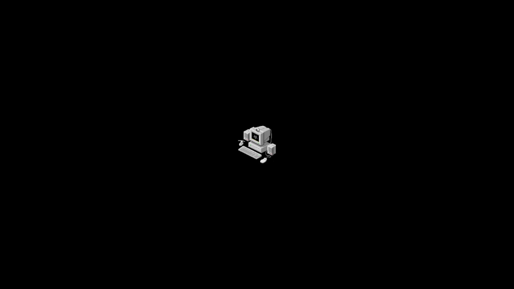

# Omarchy MonoBlood Theme

Terminal-noir dark theme for [Omarchy](https://omarchy.org) — warm stone monochrome, oxblood accents, sharp `0px` corners, and architectural borders.



## Installation

```bash
omarchy theme install https://github.com/h4mr3r/omarchy-monoblood-theme.git
```

Or apply manually after cloning into `~/.config/omarchy/themes/monoblood`:

```bash
omarchy-theme-set MonoBlood
```

## Palette

| Role | Hex | Description |
| :--- | :--- | :--- |
| `background` | `#111010` | Deep terminal-noir charcoal |
| `lighter_background` | `#191919` | Bar, tooltips, and notification cards |
| `foreground` | `#e8e2e0` | Warm bone primary text |
| `light_foreground` | `#cfc7c5` | Secondary warm stone |
| `muted` | `#6d6663` | Dim warm taupe comments & chrome |
| `selection` | `#7d1d1d` | Signature oxblood selection (`#ffffff` text) |
| `accent` / `red` | `#b52b2b` | High-contrast dark-mode crimson oxblood |
| `magenta` | `#9e2424` | Rich oxblood keywords |
| `orange` / `yellow` | `#b0451c` / `#cf7346` | Burnt rust & terracotta types/alerts |
| `green` | `#e0c8c8` | Pale rose-bone strings |

## Included Assets & Overrides

- `colors.toml` — Full Omarchy 4 semantic & ANSI palette (auto-generates terminal, Neovim `aether`, Helix, VS Code, Obsidian, and browser configs)
- `shell.toml` — Custom Quickshell surfaces with `2px` top oxblood bars on menus/popups, `4px` left oxblood stripe on notifications, and `3px` active row indicator
- `hyprland.lua` — Oxblood active border gradient, `0px` sharp corners, shadows disabled (used for local/trusted installs)
- `btop.theme` — Warm stone-to-oxblood process & graph theme
- `icons.theme` — `Yaru-red-dark`
- `backgrounds/1-monoblood-pc.png` — Centered `2560x1440` pixel-art terminal wallpaper on pure `#000000`
- `unlock.png` & `preview-unlock.png` — Oxblood Plymouth / SDDM boot & unlock screen assets
